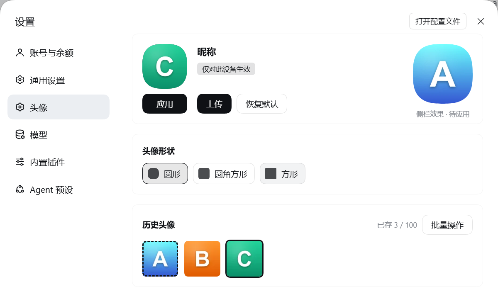
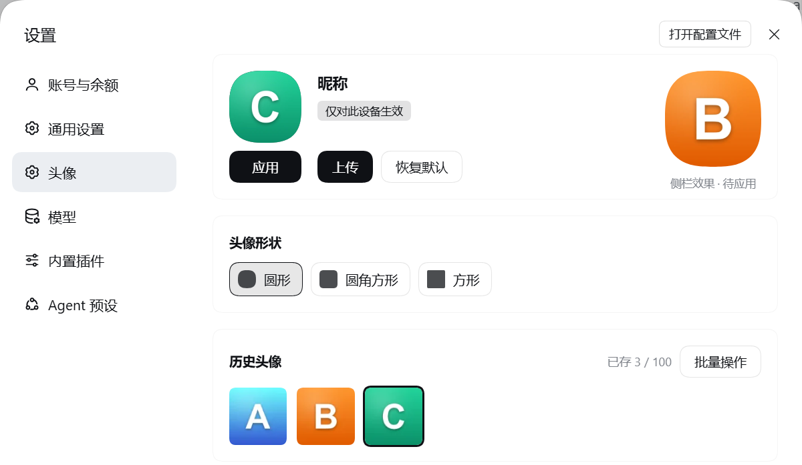
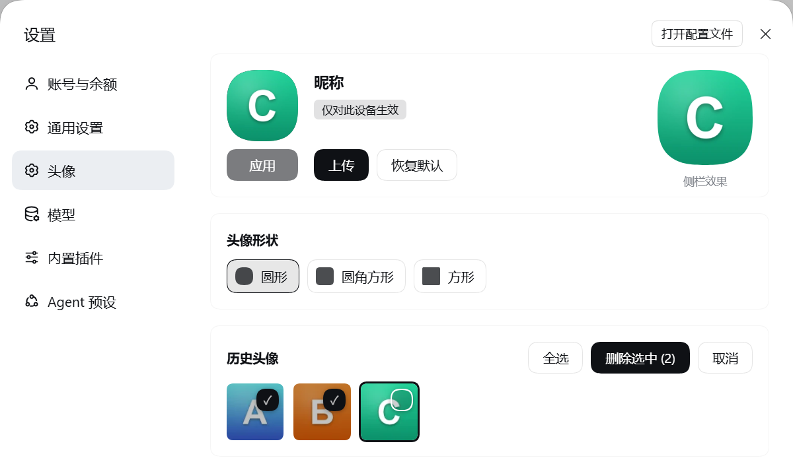

# dsh-account-avatar

<p align="center">
  🌐 <b>English</b> &nbsp;·&nbsp; <a href="README.md">简体中文</a>
</p>

Replaces the avatar at the bottom of the DeepSeek Harness sidebar with a picture you upload, and lets you set your own nickname.



## Features

The sidebar shows whatever your DeepSeek account says. Sign in with WeChat, or bind WeChat to the account, and that is your WeChat profile picture — and while the account is signed in that way, DSH offers no separate avatar setting.

DSH has no setting for this: the seat reads `AccountProfile.avatarUrl`, which is read-only, and the account service exposes no setter. This plugin paints your own picture and name over that one element, on this device only.

## Install

```sh
dsh plugin --profile web add dsh-account-avatar
```

Until it is published to npm, install straight from a checkout:

```sh
dsh plugin --profile web add /path/to/dsh-account-avatar
```

Reload the page afterwards.

## What you see in each account state

The plugin paints over DSH's own avatar seat, so what it can show depends on what that seat currently is. DSH has three account states, and each behaves differently:

| | Signed out | Signed in, no WeChat | Signed in with WeChat |
|---|---|---|---|
| **Sidebar avatar** | The plugin **inserts** a seat of its own and paints your picture | Your picture | Your picture |
| **Sidebar name** | Always reads `Not signed in` | Your custom name, else the masked contact (`1XX******XX`) | Your custom name, else your WeChat nickname |
| **With no picture uploaded** | Grey person icon | Grey person icon | **Your WeChat picture** |
| **Settings first line** | `Not signed in` | Masked contact | WeChat nickname |
| **The `@` line** | Hidden | **Hidden** | Shows `@nickname` |

### Signed out

DSH renders no avatar element here at all — the button holds an ellipsis and a "More" label. The plugin appends a 24×24 seat (ordered first with `order:-1`, which leaves React's child indexes untouched) and hides the ellipsis.

- Avatar: your uploaded picture; the grey person icon when nothing is uploaded
- Name: **always `Not signed in`**, never a name from the account that signed out
- Both the picture and the name are kept, and come back when you sign in again

### Signed in without WeChat

Such an account has **no Platform nickname** (`id_profile` is `null`), so DSH itself falls back to the masked phone number.

- Avatar: your picture; the grey person icon when nothing is uploaded
- Name: your custom name, else the masked contact
- **No `@` line**

### Signed in with WeChat

Platform returns both the nickname and the picture.

- Avatar: your picture; **your WeChat picture** when nothing is uploaded — which is the reason this plugin exists
- Name: your custom name, else the WeChat nickname
- The `@nickname` line appears

On an account switch the plugin fingerprints the identity by its masked contact, so the cache is dropped and the previous account's name never lingers in the sidebar.

## Use

Open **Settings** (`Ctrl+Alt+,`, or click the sidebar avatar → Settings) → **Avatar**.

### Change the picture

1. **Upload** — PNG, JPEG, WebP or GIF, up to 12 MB
2. Drag to reposition, scroll or use the slider to zoom
3. **Save**

The picture is stored as 256×256 and processed on this device only.

### History

Every save is kept, up to **100** pictures:

- Click a thumbnail to **pre-select** it: the right-hand preview switches immediately, the left preview and the sidebar do **not** change
- Click **Apply** under the left preview to actually use it
- Solid blue ring = in use, dashed blue ring = pre-selected
- Past 100, the **oldest** entry is dropped; the one in use is never dropped



### Bulk actions

**Bulk actions** in the history header enters selection mode:

- Each thumbnail gets a check circle
- **Select all** / **Delete selected (n)** / **Cancel**
- Deleting the entry in use falls back to the newest remaining one; delete them all and the account picture comes back



### Shape

Three options, applied globally to the sidebar avatar and the right preview (history thumbnails stay rounded squares):

| Shape | Radius |
|---|---|
| Circle | 50% |
| Rounded | 26% |
| Square | 10% |

Circle by default, matching the shipped look.

### Name

The first line is your name — **click it to edit**:

- The default follows the account state (see the table above): WeChat nickname, masked contact, or `Not signed in`
- Enter or blur saves, Esc cancels, 24 characters max
- Clearing it falls back to that same default
- The sidebar label follows whatever is shown here
- The name lives in **this browser**, never in the account

If another plugin also rewrites that label, Settings shows an amber warning next to the name and this plugin steps aside instead of fighting.

## Where it is stored

Pictures and names stay on this machine; nothing is uploaded anywhere.

**Two stores, chosen by what the shell can do:**

- **Host library** — `$DSH_HOME/account-avatar/avatars.json` (up to 100 pictures). The Host half reads and writes it through `GET/POST /account-avatar/api/state|mutate` plus `GET /account-avatar/api/image`, all passing the same `connection.requestRejection` check the shipped loopback routes use. Used **only when the shell actually mounts HTTP routes.**
- **Browser library** — `localStorage['dsh.account-avatar.library.v1']`. Desktop loads the UI over its own `dsh-app:` scheme, where a relative `/api/...` request has no handler; uploads then **fall back here automatically** with the same features.

The Host routes are probed once at startup: reachable means the Host library, unreachable means the browser library, and the page behaves identically either way.

**Other browser copies (so the first painted frame is already right):**

- `localStorage['dsh.account-avatar.v2']` — the current picture
- `localStorage['dsh.account-avatar.shape.v2']` — the shape
- `localStorage['dsh.account-avatar.name.v1']` — the custom name
- `localStorage['dsh.account-avatar.account.v2']` — cached account identity (name plus masked contact)

Each picture is kept twice: a 256×256 original (for display, usually 20–60 KB) and a 96×96 thumbnail (for the list, about 4 KB), so opening Settings does not pull the whole library.

A single-picture `avatar.json` from the first version is migrated into the history on first read.

## Limitations

- The avatar is repainted by one stylesheet keyed on the shipped `[data-avatar-status]` marker, or on a `data-ast-avatar` tag this plugin adds when that marker is absent — an account that never uploaded a picture renders the marker-less path, and the tag is what makes the replacement work there too. If a DSH release changes the launcher markup (a menu trigger no longer carrying `aria-haspopup`, or a seat that is no longer a square icon-bearing span), the tag cannot be placed and the replacement stops applying — nothing breaks, the native picture simply shows again.
- The name is written into the seat's text node. If the shipped markup changes, or another plugin writes the same node, it falls back to the native name (Settings shows a warning).
- With the browser library, clearing site data or switching browsers loses the pictures and the name; the Host library survives both.
- Local personalisation only: your DeepSeek account is untouched, so other people, browsers and machines still see the account picture and name.

## License

MIT
