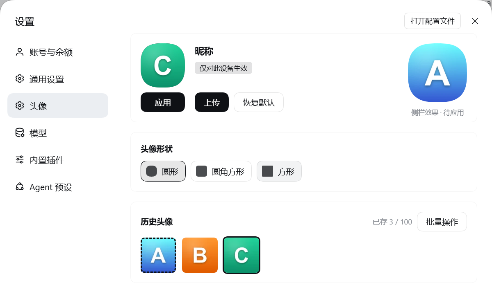
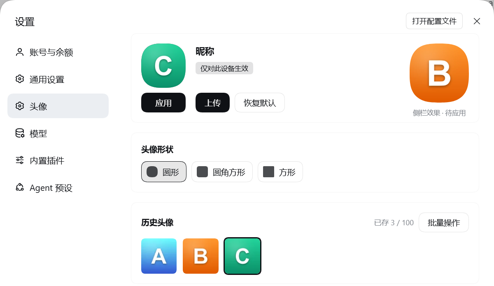
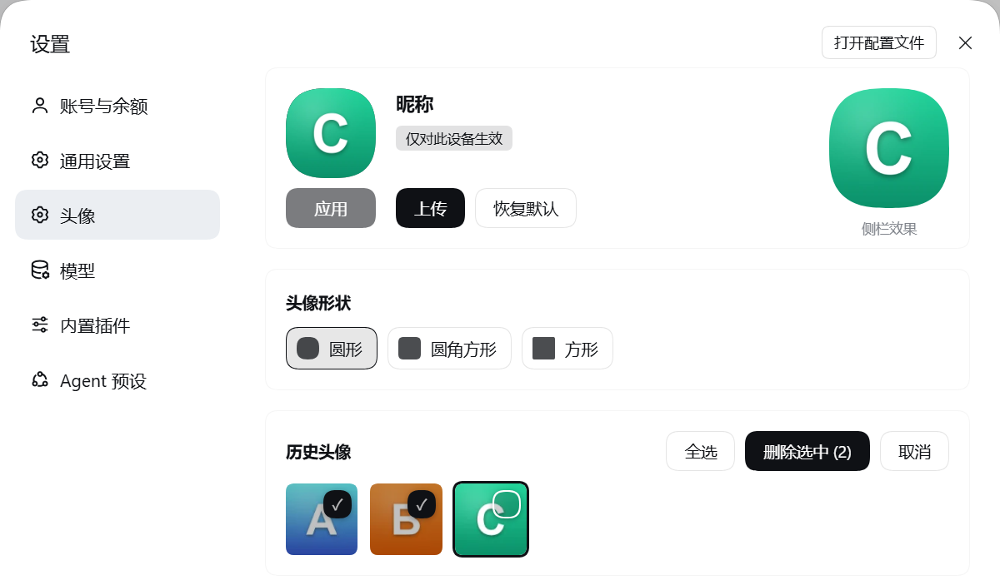

# dsh-account-avatar

<p align="center">
  🌐 <a href="README.en.md">English</a> &nbsp;·&nbsp; <b>简体中文</b>
</p>

把 DeepSeek Harness 左侧栏最下面那个头像换成可以自己上传的图像，并且可以自定义昵称。



## 功能

左侧栏显示的是 DeepSeek 平台账号的头像。用微信登录、或者把微信绑在账号上的时候，那就是微信头像 —— 而且在微信登录状态下，DSH 里没有单独改头像的入口。

DSH 本身不提供这个设置：那个位置读的是 `AccountProfile.avatarUrl`，只读，账号服务也没有任何写接口。这个插件只在自己这台设备上盖一层图和一个名字。

## 安装

```sh
dsh plugin --profile web add dsh-account-avatar
```

发布到 npm 之前，也可以直接从源码目录装：

```sh
dsh plugin --profile web add /path/to/dsh-account-avatar
```

装完刷新页面。

## 三种账号状态下的表现

这个插件要盖在 DSH 自己的头像位上，所以能显示什么，取决于那个位置当前是什么。DSH 的账号状态分三种，表现各不相同：

| | 未登录 | 登录，未绑微信 | 登录，已绑微信 |
|---|---|---|---|
| **左下角头像** | 插件**自己插入**一个头像位，显示你上传的图 | 显示你上传的图 | 显示你上传的图 |
| **左下角名字** | 常驻显示 `未登录` | 自定义名，或脱敏手机号（如 `1XX******XX`） | 自定义名，或微信昵称 |
| **没上传图时** | 灰色人形图标 | 灰色人形图标 | **微信头像** |
| **设置页第一行** | `未登录` | 脱敏手机号 | 微信昵称 |
| **`@` 那一行** | 不显示 | **不显示** | 显示 `@昵称` |

### 未登录

DSH 原本不会在这里渲染任何头像元素——按钮里只有一个省略号加「更多」。插件向按钮追加一个 24×24 的头像位（用 `order:-1` 排到最前，不破坏 React 的子节点索引），并隐藏那个省略号。

- 头像：显示你上传的图；没上传就是灰色人形图标
- 名字：**常驻显示 `未登录`**，不会显示上一个账号的名字
- 头像和名字都照常保存，登录后会继续用

### 登录但没有绑定微信

这种账号在 Platform 上**没有昵称**（`id_profile` 为 `null`），DSH 自己那行只能回退到脱敏手机号。

- 头像：显示你上传的图；没上传就是灰色人形图标（DSH 原生行为）
- 名字：你设的自定义名；没设就是脱敏手机号
- **不显示 `@` 行**

### 登录并绑定了微信

Platform 会返回微信昵称和头像。

- 头像：显示你上传的图；没上传就是**你的微信头像**（这就是做这个插件的原因）
- 名字：你设的自定义名；没设就是微信昵称
- 显示 `@昵称` 那一行，标明这个账号本身叫什么

换账号时，插件用「脱敏联系方式」做指纹来识别身份变化，缓存会自动失效，不会把上一个账号的名字留在侧栏。

## 使用

打开 **设置**（`Ctrl+Alt+,`，或点左下角头像 → 设置）→ 左侧选 **头像**。

### 换头像

1. 点 **上传** → 选一张 PNG / JPEG / WebP / GIF（12 MB 以内）
2. 在弹出的窗口里拖动定位、滚轮或滑块缩放
3. 点 **保存**

图片会存成 256×256，只在这台设备上处理。

### 历史头像

每次保存都会进历史，最多留 **100 张**：

- 点任意一张 = **预选**：右侧「侧栏效果」立刻变成那张，**左侧和左下角不动**
- 点左侧头像下面的 **应用** = 真正换上（左侧、右侧、左下角一起变）
- 正在用的那张是实心蓝框，预选的那张是虚线蓝框
- 存满 100 张后再存，会顶掉**最旧**的一张；当前那张永远不会被顶掉



### 批量操作

点历史区右上角的 **批量操作** 进入选择模式：

- 每张缩略图右上角出现勾选圆圈
- **全选** / **删除选中 (n)** / **取消**
- 删掉的如果包含正在用的那张，会自动退到剩下的最新一张；全删光就回到账号头像



### 头像形状

三个选项，全局生效，作用于左下角头像和右侧预览（历史缩略图固定圆角方块，不受影响）：

| 形状 | 圆角 |
|---|---|
| 圆形 | 50% |
| 圆角方形 | 26% |
| 方形 | 10% |

默认圆形，跟原生一致。

### 名字

第一行是名字，**点一下就能改**：

- 默认值跟着账号状态走（见上面的三种状态表）：微信昵称、脱敏手机号，或未登录时的 `未登录`
- 回车或点别处保存，Esc 取消，最长 24 字
- 清空则回落到上面的默认值
- 改完会同步显示在左下角头像旁边
- 名字存在**本机浏览器**里，不进账号、不上传

如果别的插件也在改那个位置的名字，设置页会在名字右边出现橙色提示并且本插件会让位

## 存放位置

图片和名字都只在这台设备上，不上传任何服务器。

**存两份，按外壳能力自动选：**

- **Host 图库** —— `$DSH_HOME/account-avatar/avatars.json`（最多 100 张），由 Host 半边通过 `GET/POST /account-avatar/api/state|mutate` 和 `GET /account-avatar/api/image` 读写，三条路由都过了和官方本机路由同一套 `connection.requestRejection` 检查。**仅当外壳确实挂了 HTTP 路由时使用。**
- **浏览器图库** —— `localStorage['dsh.account-avatar.library.v1']`。桌面端用自定义 `dsh-app:` 协议加载界面，相对路径的 `/api/...` 请求没有处理器，此时上传会**自动落到这里**，功能完全一样。

启动时探测一次 Host 路由：能通就用 Host 图库，不能通就用浏览器图库，页面上的操作和表现没有区别。

**浏览器里的其他副本（首帧就画对，避免先闪一下原生头像）：**

- `localStorage['dsh.account-avatar.v2']` —— 当前那张
- `localStorage['dsh.account-avatar.shape.v2']` —— 形状
- `localStorage['dsh.account-avatar.name.v1']` —— 自定义名字
- `localStorage['dsh.account-avatar.account.v2']` —— 账号身份缓存（名字 + 脱敏联系方式）

每张图存两份：256×256 原图（显示用，通常 20–60 KB）和 96×96 缩略图（历史列表用，约 4 KB），所以打开设置不用把整库原图都拉下来。

旧版本的单张 `avatar.json` 会在第一次读取时自动迁移成历史里的第一张。

## 已知限制

- 头像靠一条作用在官方 `[data-avatar-status]` 标记（或插件自己打的 `data-ast-avatar` 标记）上的样式重绘。如果某个 DSH 版本改了账号菜单结构，替换会失效 —— 不会报错，只是又显示回原生头像。
- 名字靠改写账号位里的文本节点。原生结构变了、或者有其他插件也在写同一个位置时，会退化成显示原生名字（设置页会有提示）。
- 用浏览器图库时，清浏览器缓存或换浏览器会丢图和名字；用 Host 图库时不会。
- 纯本机个人化：DeepSeek 账号完全没动，别人、别的浏览器、别的机器看到的仍是账号头像和账号名。

## 许可

MIT
